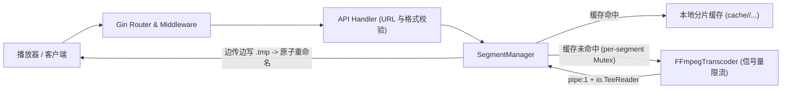

# PlugStream 架构设计

## 目录结构

```text
PlugStream/
├── cmd/server/main.go               # 程序入口、信号处理与优雅关闭
├── internal/
│   ├── api/
│   │   ├── router.go                # Gin 路由与日志/CORS/恢复中间件
│   │   └── handler.go               # HTTP 接口校验、Range 处理与流式输出
│   ├── config/
│   │   ├── config.go                # Viper 配置加载与合法性校验
│   │   └── config_test.go           # 配置单元测试
│   ├── logger/
│   │   └── logger.go                # Logrus 结构化日志初始化
│   ├── segment/
│   │   └── manager.go               # 分片缓存、并发互斥、M3U8 生成与定时清理
│   └── transcoder/
│       ├── transcoder.go            # FFmpeg/ffprobe 封装与并发信号量控制
│       └── transcoder_test.go       # 转码器参数构建与上下文取消测试
├── examples/player.html             # 浏览器端播放示例
├── config.yaml                      # 默认配置文件
├── Dockerfile                       # 多阶段镜像构建
└── docker-compose.yml               # 容器编排配置
```

## 核心请求链路



## 模块职责

### 1. API 层 (`internal/api`)

- `router.go`：注册 `/api/v1/health` 与 `/api/v1/video/*` 路由，挂载请求耗时日志、Panic 恢复和 CORS 中间件。
- `handler.go`：
  - 校验请求中的 `url` 必须为 `http`/`https` 协议且包含主机名，校验 `format` 仅允许 `mp4`、`ts`、`hls-fmp4`。
  - `StreamVideo` 支持无 `Range` 的首片流式输出，以及基于 RFC 7233 解析的 `bytes=start-end`、`bytes=start-`、`bytes=-suffix` 请求。
  - `GetHLSPlaylist` 返回 VOD M3U8 文本；`GetSegment` 与 `GetHLSSegment` 返回对应格式的分片字节流。

### 2. 分片管理与缓存 (`internal/segment`)

- **缓存路径分桶**：对 `videoURL` 计算 MD5 十六进制串，取前两位作二级目录，文件名为 `<hash>_seg_<index>.mp4`（默认）或 `<hash>_seg_<index>.<format>`。
- **并发去重**：通过 `segmentLocks`（`sync.Map` 存储每分片一把 `*sync.Mutex`）防止同一分片同时触发多个 FFmpeg 进程；锁内执行双重检查。
- **边转码边写盘**：使用 `io.TeeReader` 将 FFmpeg 的标准输出同时送给 HTTP 响应和 `.tmp` 临时文件，读取器关闭时再重命名为正式缓存文件，避免读到半成品。
- **元数据缓存与清理**：`videoInfoCache` 缓存 `ffprobe` 探测结果；后台协程按 `cache.cleanup_interval` 周期扫描并清理超过 `cache.expiration` 的缓存文件。

### 3. 转码引擎 (`internal/transcoder`)

- 启动时检查 `ffmpeg -version`，确保转码命令可用。
- 使用缓冲通道 `taskSem` 限制最大并发转码数（`server.max_concurrent_tasks`）。
- `GetVideoInfo` 调用 `ffprobe -print_format json -show_format -show_streams` 解析时长、分辨率、码率与音视频编码。
- `buildFFmpegArgs` 按目标格式构建向标准输出 `pipe:1` 写入的参数：
  - `mp4`：使用 `-movflags frag_keyframe+empty_moov+default_base_moof -f mp4`，支持直接流式输出。
  - `hls-fmp4`：在 fMP4 参数基础上增加 `-fflags +genpts -reset_timestamps 1`。
  - `ts`：使用 `-bsf:v h264_mp4toannexb -f mpegts`。
- `transcoderReader.Close` 会在关闭管道后等待进程退出，并在 5 秒超时后强制结束子进程，防止僵尸进程残留。

## 已知限制

- `StreamVideo` 的 `Range` 分片索引基于 `2Mbps` 固定码率估算，对于可变码率视频，精确进度跳转推荐使用 HLS 接口或按索引请求的 `/api/v1/video/segment`。
- 默认使用软件编码（`libx264` + `aac`），暂未内置硬件加速与多音轨切换。
- `cleanupCache` 当前按过期时间清理文件，容量超出 `max_size` 时仅记录警告日志。
